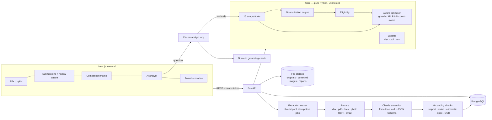

# Architecture

## Data flow
1. **RFx**: drafted with the co-pilot (Claude → `update_rfx_draft` tool, which returns the full draft as JSON; that JSON is validated, and a line-count check and pricing-basis checks are run on it), edited, then published. Publishing records invitations; email sending is stubbed.
2. **Ingestion**: upload → extension + magic-byte check → sha256 → versioned `documents` row → `extraction_jobs` row (idempotency key = hash + kind + model + prompt version) → background run.
3. **Parsing**: each format becomes numbered **segments** with locators. Spreadsheets are split by sheet and row, PDFs by page, line and bbox (fine print is marked), Word files by paragraph or sentence and by table row, photos by OCR line with a bbox on the perspective-corrected image, and emails by header and line (quoted history is marked). Segments are stored in `source_evidence` and are the unit of provenance.
4. **Extraction**: Claude receives the RFx lines and the segments (plus the corrected image for photos) wrapped as untrusted data. It must return `record_quotation` matching the schema, and validation errors are fed back for up to 3 attempts.
5. **Grounding**: deterministic checks produce per-value confidence and review flags, plus coverage (`QUOTED / NOT_QUOTED / NEEDS_CLARIFICATION / UNREADABLE`) and exceptions. The full outcome is stored in `extraction_results` (JSONB) and the line items in `extracted_line_items`.
6. **Review**: buyer actions (`CONFIRM / CORRECT / ACCEPT_ASSUMPTION / MARK_*`) go to `field_reviews` and are layered on top of extraction; they never overwrite it.
7. **Analysis context**: rebuilt per request from the DB: latest extraction per vendor, then corrections, normalization, questionnaire evaluation (certificate evidence plus overrides), then the saved scenarios. A snapshot is written to `normalized_quotations` after every change.
8. **Award**: optimiser → `award_scenarios` and `award_allocations` → human approval, which is blocked while awarded values are unverified → PDF.

## AI workflow boundaries
| Step | Model does | Code does |
|---|---|---|
| RFx draft | proposes the structure, asks questions | validates the schema, counts lines, checks the pricing basis |
| Extraction | reads values as written, cites them, flags oddities | verifies citations and numbers, scores, routes to review |
| Certificate | reads the holder, number and expiry | grounds the expiry date, compares it to the RFx date |
| Analyst | picks tools, explains the results | computes every number, checks the answer's numbers |

## Key modules
- `backend/app/extraction/`: `parsers.py`, `image_prep.py` (OpenCV page detection and warp, Tesseract), `pipeline.py`, `grounding.py`
- `backend/app/normalization/`: `engine.py` (FX, UOM, discounts, tax, freight; traces), `weight.py`, `adapter.py`
- `backend/app/quality/eligibility.py`, `backend/app/optimization/award.py`
- `backend/app/analyst/`: `tools.py` (15 tools), `agent.py` (loop plus numeric grounding), `builder.py`, `context.py`
- `backend/app/services/rfx_service.py`: DB ↔ core, jobs, persistence, exports
- `backend/app/api/`: REST routes; `backend/app/db/models.py`: schema
